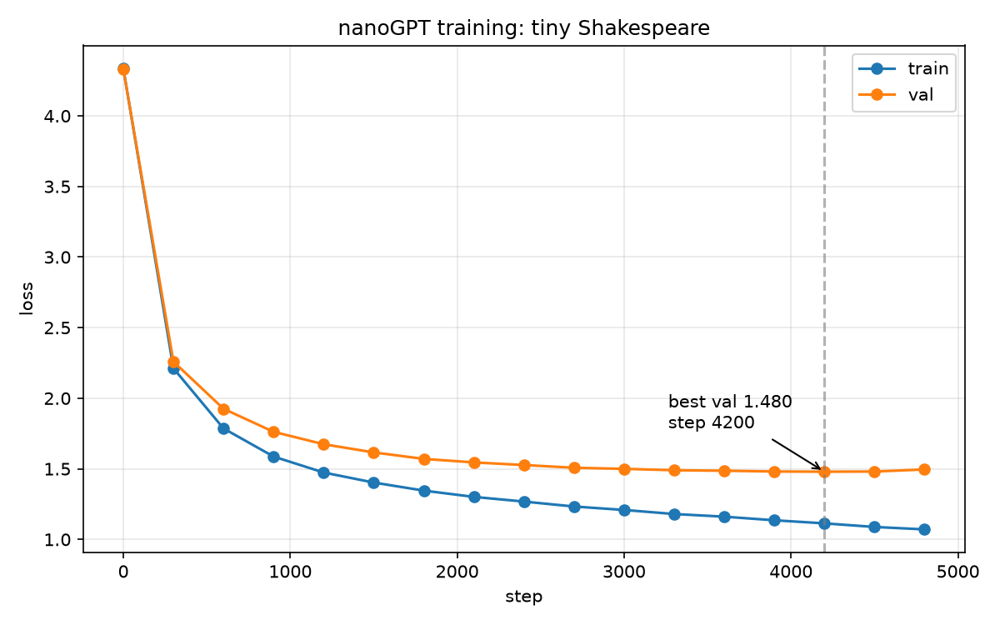

# nano-gpt



## Sample output

```
Second Servingman:
Here comes well.

First Servingman:
Mighty lord.

PETER:
Let's be red. They pitiful in the sweet youth, a
cared of death.

Second Servant:
Up:
He shall be rid upon to-night. if you'll be married.

First Senator:
Have you not to return?

First Officer:
There's no needs. Alack, o sir, and would rather both.

Second Servingman:
Then, at noise. The store noble covertain direction
eat and reputation would the dust on him.

First Citizen:
Mercution, I saw her from our tstander battl
```
